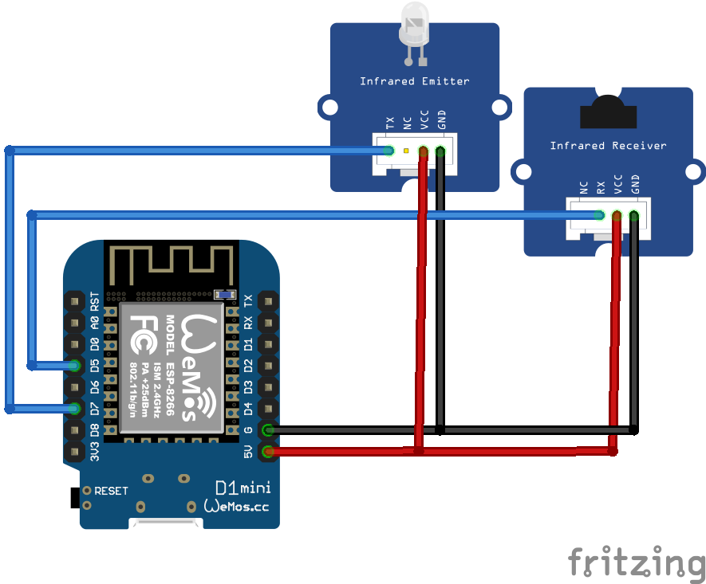
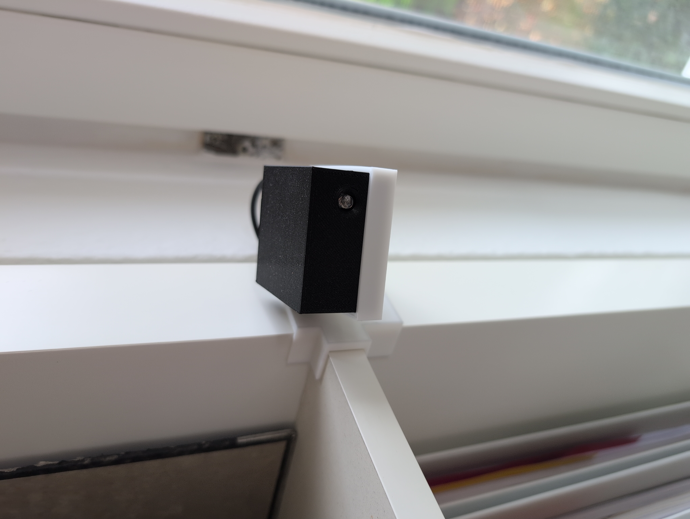
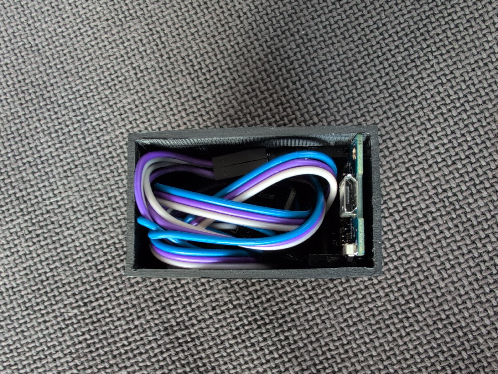
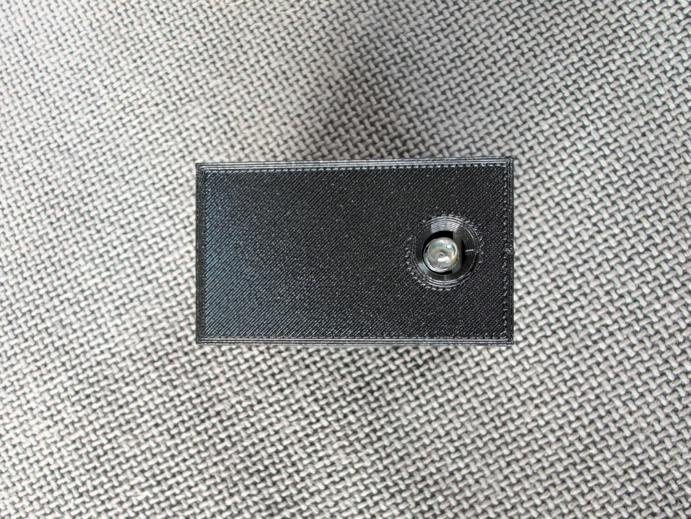

# ESP8266 Home Assistant Button

An infrared replicator based on an ESP8266 for use with [Home Assistant](https://www.home-assistant.io/).

Heavily based on https://community.home-assistant.io/t/faking-an-ir-remote-control-using-esphome/369071

The ESP connects to Wi-Fi and can be used to replace IR remotes and control the devices from Home Assistant. The enclosure is 3D printed, with the electronics mounted inside.

# Features
 - ESP8266-based
 - Wi-Fi connected
 - Integrates with Home Assistant
 - Custom 3D-printed enclosure
 - IR replicator
 - Configured using ESPHome

# Hardware
 - Wemos D1 Mini Board
 - IR receiver
 - IR emitter

# Wiring

# 3D-Printed Parts

The enclosure is available on [Thingiverse](https://www.thingiverse.com/thing:7421043)

# ESPHome Configuration

The button is configured using ESPHome.

# Programming

Instructions on how to record the specific protocol of your remote can be found here: https://community.home-assistant.io/t/faking-an-ir-remote-control-using-esphome/369071

# Photos

